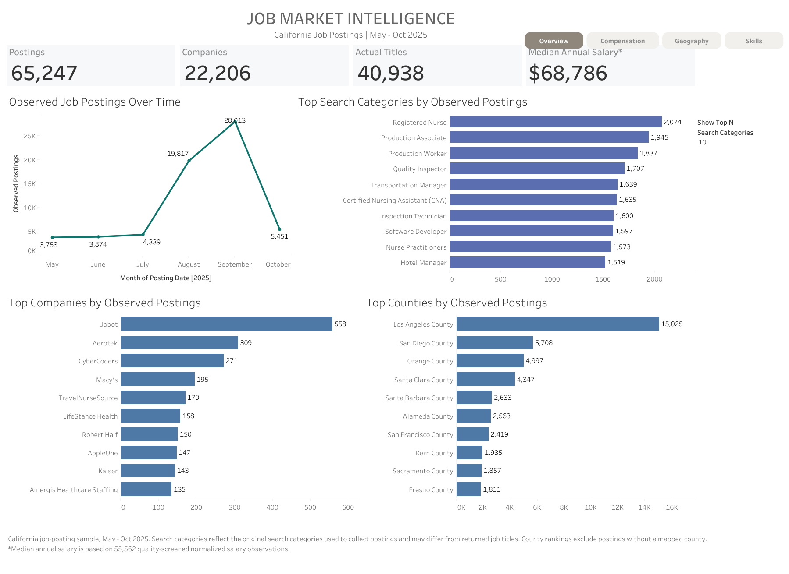

# Job Market Intelligence Pipeline

**Python · SQL · MySQL · NLP · Tableau · Data Analytics**

This repository presents the **Job Market Intelligence Pipeline**, originating from my 2025 internship at AllSumJobs.

The project transforms large-scale job-posting data into actionable insights about hiring activity, compensation, geographic opportunities, and employer skill requirements. It combines data engineering, SQL analytics, NLP-based skill extraction, production quality assurance, and interactive Tableau dashboards.

## Project at a Glance

| Metric | Result |
|---|---:|
| Job postings analyzed | **65,247** |
| Postings with usable salary data | **55,562** |
| Postings processed for skill extraction | **64,283** |
| Extracted posting-skill records | **1,096,311** |
| Postings with at least one extracted skill | **97.31%** |
| Interactive Tableau dashboards | **4** |

These metrics describe different analytical populations and processing stages rather than one interchangeable denominator.

## Engineering & Analytical Highlights

Beyond building dashboards, the project addresses several challenges in turning real-world, model-derived data into trustworthy analytical outputs.

### 1. Preserving Metric Integrity Across Data Transformations

**Challenge:** Transforming skill extraction outputs into a long-format dataset can silently exclude job postings with no retained skills, inflating reported skill prevalence.

**Approach:** Preserved the complete population of 64,283 processed postings, including 1,730 zero-skill records, and maintained separate posting-level and skill-level analytical tables.

**Why it matters:** A metric can be calculated correctly while answering the wrong question if its underlying population has changed.

### 2. Building Reliability Into Production NLP Processing

**Challenge:** API rate limits and interrupted processing can leave production extraction results incomplete or inconsistent.

**Approach:** Established a conservative 4,100-record at-risk repair scope, supported by preflight validation, backups, integrity checks, controlled recovery procedures, and post-run QA.

**Why it matters:** Production recovery should be auditable and narrowly scoped, rather than relying on unverified blanket reruns.

### 3. Converting Noisy NLP Outputs Into Defensible Skill Analytics

**Challenge:** Model-extracted text can mix genuine skills with qualifications, credentials, application instructions, and employer context.

**Approach:** Built a normalization and filtering workflow with human-reviewed policies, residual qualification review, and geographic reference standardization. The final Tableau capability scope contains 984,259 posting-capability records.

**Why it matters:** NLP outputs are useful analytical features only when their limitations, definitions, and downstream transformations are explicitly managed.

### 4. Testing Model Changes Without Overfitting to Known Failures

**Challenge:** Improvements on previously examined examples do not necessarily generalize to unseen job descriptions.

**Approach:** Used exposed regression sets, frozen candidate fingerprints, two independent 288-record blind evaluations, failure diagnostics, and targeted architecture experiments.

**Decision:** Experimental replacements were not promoted to production because they did not demonstrate sufficiently stable generalization over the established baseline.

**Why it matters:** Reliable engineering involves knowing when *not* to deploy a proposed improvement.

**[Read the Detailed Reliability Evaluation](docs/reliability-evaluation.md)**

## Interactive Tableau Dashboard

The completed **Job Market Intelligence** Tableau dashboard explores California job postings from May to October 2025.

*Market Overview dashboard. Click the image to explore all four interactive views.*

**[Explore the Interactive Dashboard](https://public.tableau.com/views/JobMarketIntelligence_17910480871610/MarketOverview)**

| Dashboard | Analytical focus |
|---|---|
| **Market Overview** | Hiring activity, posting composition, and market trends |
| **Compensation Landscape** | Salary distributions and comparisons across segments |
| **Geographic Opportunity** | Regional hiring and compensation patterns |
| **Skills Intelligence** | Skill demand, segment-level prevalence, and county context |

The four dashboards share a unified navigation system and provide an interactive view of the completed analytical results.

## Pipeline Architecture

The historical project architecture connects job-posting collection, MySQL / AWS RDS storage, NLP skill extraction, and Tableau reporting.

The repository organizes the supporting code into four main analytical workstreams:

| Component | Responsibility | Source |
|---|---|---|
| Job Market | Data recovery, validation, analytical dataset construction, SQL analysis | [View code](analytics/01_job_market/) |
| Skill Production | NLP processing, rate-limit recovery, production QA | [View code](analytics/02_skill_production/) |
| Skill Evaluation | Sample construction, blind evaluation, failure analysis | [View code](analytics/03_skill_evaluation/) |
| Skills Intelligence | Skill normalization, qualification filtering, county mapping, Tableau preparation | [View code](analytics/04_skills_intelligence/) |

### Core Components

- [Production skill extractor](src/skill_extraction.py)
- [SQL analytics](sql/)
- [Baseline implementations](baselines/)
- [Model and provider experiments](experiments/)
- [Human-reviewed reference data](data/reference/)

## Technology Stack

| Area | Technologies |
|---|---|
| Data processing and analytics | Python, Pandas, NumPy |
| Database and querying | MySQL, AWS RDS, SQL, SQLAlchemy |
| NLP and evaluation | LLM-based extraction, Transformers, regression and blind evaluation |
| Data visualization | Tableau |
| Data quality | Validation scripts, reconciliation checks, SHA-256 integrity verification |

## Documentation & Reproducibility

| Document | Contents |
|---|---|
| [Reliability Evaluation](docs/reliability-evaluation.md) | Experimental methodology, blind testing, failure analysis, architecture decisions |
| [Reproducibility and Data Availability](docs/reproducibility.md) | Environment, workflow dependencies, data availability, and reproduction limitations |
| [Python Dependencies](requirements.txt) | Dependency versions recorded for the public repository |

This repository provides the project code, analytical methodology, and selected human-reviewed reference data. Original job descriptions, private database contents, and full production outputs are not publicly distributed.

The published Tableau dashboards serve as the primary interactive artifact for exploring the final analytical results.